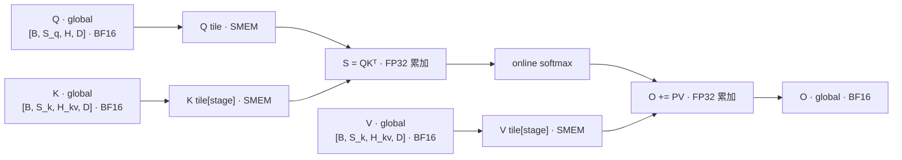
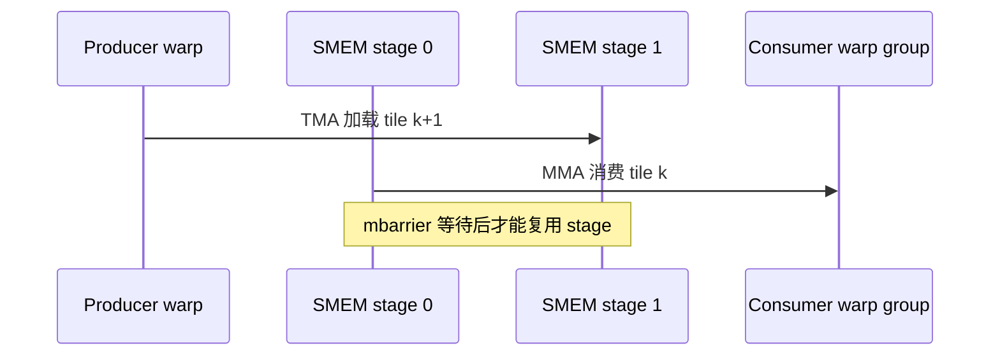

# 图表、公式与代码

仅在技术报告需要示意图、时间线、公式、张量 shape 记法或源码引用时读取本文件。

## 按读者的问题选图

先确定一幅图要回答什么问题，再选图。两幅有用的图胜过一组原始工具截图。

| 读者的问题 | 适合的图 | 证据来源 |
| --- | --- | --- |
| 算子算什么 | 数据流图（输入 → 计算阶段 → 输出） | 参考实现、公式 |
| 工作如何划分 | grid → cluster → CTA → warp → thread 层级图 | kernel 源码、launch 配置 |
| 数据在哪里、怎么流动 | HBM → SMEM → 寄存器/TMEM 的存储层级图 | 源码、编译产物 |
| 流水线如何重叠 | 生产者/消费者阶段图、buffer 版本图 | 源码（示意）或 IKET、nsys（实测） |
| 哪个线程持有哪个元素 | layout 图 | CuTe layout、TileLang layout 工具 |
| 时间花在哪里 | 截取关键区间的时间线 | nsys、IKET、PM sampling |
| 性能是否改善 | 小型对比表或柱状图 | benchmark |
| 请求或训练 step 如何流转 | 生命周期图、时序图 | 框架源码 |

## 图注

每幅图都有编号、标题、证据等级和一句话结论：

```markdown
**图 3｜decode 阶段 split-KV 的 CTA 划分（示意；B=1、H=8、S_k=32K）**

按 (batch, head) 划分时只有 8 个 CTA；沿 KV 长度切分后增加到 8×切分数，代价是一次额外的归约。
```

- 证据等级使用「示意」「设计」「引用」「源码」「估算」「编译产物」「实测」之一；实测图写明 GPU、shape 和工具，引用图写明出处。
- 一句话结论放在图下方，说明读者应该从图中看出什么。
- 同一幅图出现多个证据等级时（例如 roofline 图中的估算上限与实测点），用不同图形元素区分，并在图例中标注证据等级。编译器事件顺序和运行时时间不共用一条坐标轴。
- 示意图中箭头的间距不代表时间。需要表达时间关系时，使用实测时间线或标明「示意，不按比例」。

## Mermaid 模式

数据流图：



实线表示数据依赖；同步或所有权交接使用虚线，并在图注中说明。

流水线依赖图：



发布注意：知乎和部分文档平台不渲染 Mermaid。发布到这些平台前，把 Mermaid 导出为 SVG 或 PNG，并保留 Mermaid 源码在仓库中。目标平台只支持纯文本时，使用 ASCII 图，并放进代码块防止排版被破坏。

## 公式

- 行内公式使用 `$...$`，独立公式使用 `$$...$$`。目标平台不支持 LaTeX 时，改用代码块中的纯文本公式。
- 公式前先定义符号和单位；同一符号全文只表示一个量。
- 公式结果属于估算，引用时标注「估算」并写明参数取值。

常用估算公式：

- GEMM 计算量：$\text{FLOP} = 2MNK$。
- GEMM 理想访存量（每个矩阵只读写一次）：$\text{Bytes} = (MK + KN)\,s_{in} + MN\,s_{out}$，其中 $s$ 为每个元素的字节数。
- 算术强度：$I = \text{FLOP} / \text{Bytes}$。
- roofline 上限：$P \le \min(P_{peak},\ I \times BW_{peak})$，写明 $P_{peak}$ 与 $BW_{peak}$ 的口径。
- attention 前向计算量（非 causal，只计 $QK^\top$ 与 $PV$ 两次矩阵乘）：$2\,B\,H_q\,S_q\,S_k\,(D_{qk} + D_v)$；$D_{qk} = D_v = D$ 时即 $4\,B\,H_q\,S_q\,S_k\,D$。causal 只有在 $S_q = S_k$ 时约为一半；decode、chunked prefill 等 $S_q \ne S_k$ 的情况按未被 mask 的元素数计算。

计算量口径需要在报告中写明：

- attention 的 TFLOPS 是否计入被 mask 掉的部分。
- 反向计算量的计法。FlashAttention 系列论文按前向的 2.5 倍计（引用）；采用其他计法时写明。
- GQA、MQA、MLA 写明 $H_q$、$H_{kv}$、$D_{qk}$、$D_v$ 的取值。
- MFU 写明计算量公式是否包含 attention、是否计入重计算。

## shape、dtype 与 layout 记法

- 张量 shape 使用方括号和具名维度，例如 `[B, S, H, D]`。首次出现时定义每个维度。
- 常用维度字母：B 为 batch，S 为序列长度（区分 $S_q$、$S_k$），H 为 head 数（区分 $H_q$、$H_{kv}$），D 为 head dim，M、N、K 为 GEMM 维度，E 为 expert 数。
- tile 尺寸写作 `128×128×64`，并在括号中说明维度顺序，例如（M×N×K）。正文使用乘号 `×`，代码中保持原样。
- dtype 使用大写，并区分输入与累加精度，例如「BF16 输入，FP32 累加」「FP8（E4M3）权重，per-block 缩放因子」。
- layout 写明主序和连续维度，例如 row-major、K-major；CuTe layout 写在代码中，例如 `(M,K):(K,1)`。

## 代码与源码引用

- 源码引用写「路径 + 函数或类 + commit」，例如 `python/sglang/srt/mem_cache/radix_cache.py::RadixCache.match_prefix @<commit>`。只写行号时必须同时给出 commit，行号会随版本变化。
- 链接使用带 commit 的固定链接，不使用会变化的分支链接。
- 代码片段只保留支撑论点的关键行；删去的部分用注释 `// ...` 或 `# ...` 标出，不改写保留下来的代码。
- 伪代码在代码块前标注「伪代码」，不与真实代码混用。
- 代码块标注语言，例如 `cuda`、`python`、`bash`、`text`。
- 命令写成可直接复制运行的形式，包括必要的环境变量；输出只截取相关部分，并标注「输出节选」。
